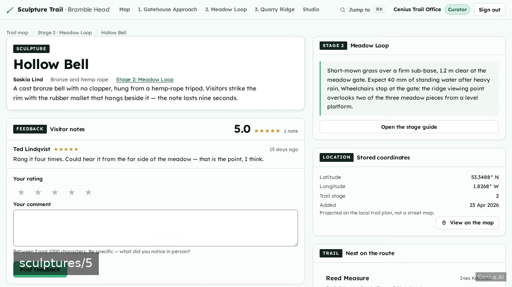
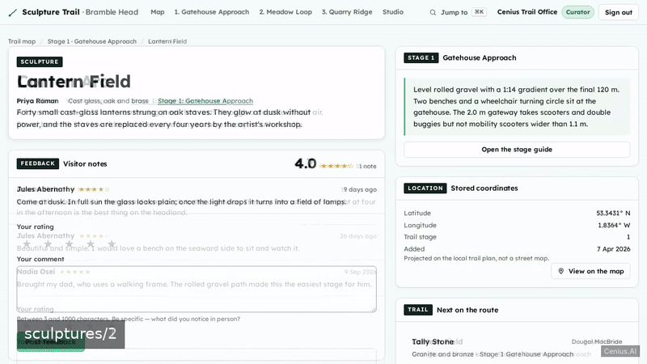
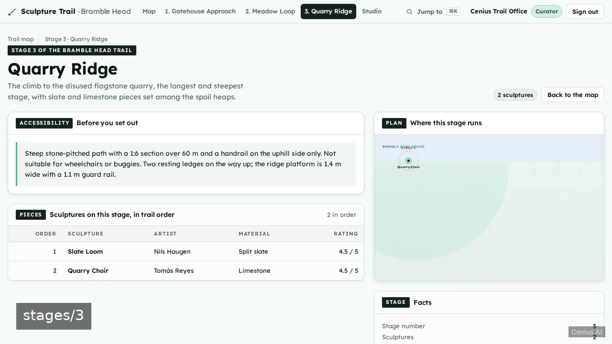
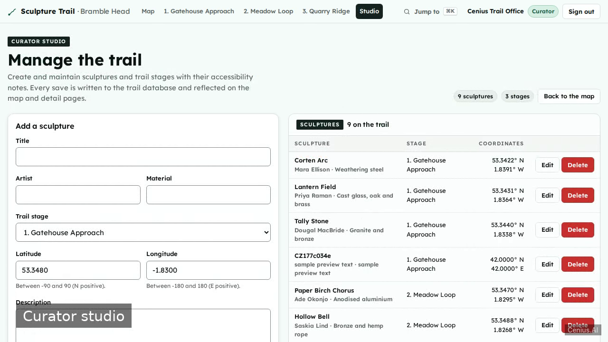

# Sculpture Trail Visitor Map — complete Full-stack app monitoring dashboard example app

Clone it. Run it. Own it. **Sculpture Trail Visitor Map** is a complete, Apache-2.0-licensed monitoring dashboard in Full-stack app — full source, demo data included. We will build a clean, minimal full-stack Sculpture Trail Visitor Map on Sanic and SQLite. Self-host Sculpture Trail Visitor Map on your own infrastructure, or open it on [cenius.ai](https://cenius.ai/marketplace/p/sculpture-trail-visitor-map?ref=gh&utm_campaign=sculpture-trail-visitor-map-webapp) to request changes and get a Sculpture Trail Visitor Map fresh build.


[](LICENSE)  [](https://cenius.ai)

[](https://cenius.ai/marketplace/p/sculpture-trail-visitor-map?ref=gh&utm_campaign=sculpture-trail-visitor-map-webapp)

> **▶ [Open & edit in cenius.ai](https://cenius.ai/marketplace/p/sculpture-trail-visitor-map?ref=gh&utm_campaign=sculpture-trail-visitor-map-webapp)** — one click to an editable workspace: describe changes in plain English, get an instant preview, one-click deploy and host. Modifications made on the platform come with full rebrand & relicense rights.

_Local clone? See [Quick start](#quick-start) below. cenius.ai is the zero-setup path._

## Demo





▶ **[Full demo walkthrough](https://cenius.ai/marketplace/p/sculpture-trail-visitor-map?ref=gh&utm_campaign=sculpture-trail-visitor-map-webapp)** — watch it on the project page · [download MP4](.github/media/demo.mp4)

## Screenshots

  

## Features

- Email/password authentication
- Interactive sculpture map dashboard
- Trail stage guide with accessibility notes
- Sculpture detail with artist and material
- Visitor feedback per sculpture
- Curator sculpture management
- Curator trail stage management

## Quick start

```bash
./install.sh   # installs dependencies + seeds demo data
```

See [`INSTALL.md`](INSTALL.md) for full setup and usage instructions.

## Usage guide

Start the app (`python3 app.py`) and open <http://localhost:8000>.

### Sign in

The sign-in card lists the demo credentials and includes a **Sign in with the curator demo**
button that fills and submits the form in one click.

- Curator: `cenius@cenius.ai` / `cenius`
- Visitor: `visitor@example.com` / `trail1234`

Wrong credentials always produce the same single message so the form never reveals which
accounts exist. Use the **Show/Hide** control beside the password field to check what you typed.

New here? **Create one** on the sign-in card: display name, email, password (8+ characters) and
confirmation. You are signed in immediately and land back on the page you originally asked for.

### The trail map (home)

- **Pins** are projected from each sculpture's stored latitude/longitude onto a local SVG plan.
  Drag to pan, scroll or use **+ / −** to zoom, **Reset view** to return.
- **Click or Tab to a pin** and press Enter to open its popup: title, artist, material, stage,
  and an **Open sculpture** link.
- **Stage filter** (top right of the map) narrows pins, the stage list and the index table to one
  stage. A spinner-free skeleton shows while the request is in flight; if the request fails, a
  banner offers **Try again**. **Show the whole trail** clears the filter.
- The **Stages** panel lists every stage with its accessibility-note preview and piece count.
- The **Index** table lists all sculptures in trail order with artist, material, stage and
  average rating.

### Stage guide

Open a stage from the map panel, the nav bar, or `/stages/:id`. Each guide shows:

_Full guide: [`USAGE.md`](USAGE.md)_

## Architecture

Everything runs out of the box: a Full-stack app codebase (62 files). One command (`./install.sh`) covers dependency setup and demo-data seeding. Top-level layout: `routes/`, `tests/`, `web/`. Step-by-step setup guide: [`INSTALL.md`](INSTALL.md).

## FAQ

### What's the quickest way to self-host Sculpture Trail Visitor Map?

Pull the repo, run `./install.sh`, and you are up — the script installs packages and pre-seeds the database. [`INSTALL.md`](INSTALL.md) covers any platform-specific tweaks.

### Can non-developers customise Sculpture Trail Visitor Map?

Open it on [cenius.ai](https://cenius.ai/marketplace/p/sculpture-trail-visitor-map?ref=gh&utm_campaign=sculpture-trail-visitor-map-webapp) and describe the changes you want in plain English — the platform modifies the app and gives you a new, downloadable build.

### Is Sculpture Trail Visitor Map free for commercial use?

The code is under the Apache-2.0 license, which allows commercial use without restriction. You can build, sell, and deploy it freely. Full text: [LICENSE](LICENSE).

### Can I rebrand or white-label Sculpture Trail Visitor Map?

Yes — and the easiest way is [remixing it on cenius.ai](https://cenius.ai/marketplace/p/sculpture-trail-visitor-map?ref=gh&utm_campaign=sculpture-trail-visitor-map-webapp): modifications made on the platform come with full rebrand and relicense rights over your derivative.

### How is Sculpture Trail Visitor Map built technically?

Sculpture Trail Visitor Map is a Full-stack app application — and this repository holds the complete, runnable source, not a stripped-down sample. Highlights include sculpture detail with artist and material.

## License & rebranding

Released under the [Apache License 2.0](LICENSE) (© 2026 Cenius AI) — free for personal and commercial use. The Cenius name/logo are trademarks (see NOTICE).

**Need a customized version?** [Remix this app on cenius.ai](https://cenius.ai/marketplace/p/sculpture-trail-visitor-map?ref=gh&utm_campaign=sculpture-trail-visitor-map-webapp) — modifications made on the platform come with **full rebrand & relicense rights** over your derivative.

## Built with cenius.ai

This entire application — code, design, seeded demo data — was generated on **[cenius.ai](https://cenius.ai)** from a plain-English description.

- 🚀 [Build your own app on cenius.ai](https://cenius.ai)
- 🎛️ [Remix Sculpture Trail Visitor Map on the marketplace](https://cenius.ai/marketplace/p/sculpture-trail-visitor-map?ref=gh&utm_campaign=sculpture-trail-visitor-map-webapp) — open it in a workspace, prompt for changes, and ship your own version.

More open-source apps: [the Cenius-ai catalog](https://github.com/Cenius-ai) · [showcase index](https://github.com/Cenius-ai/showcase)
